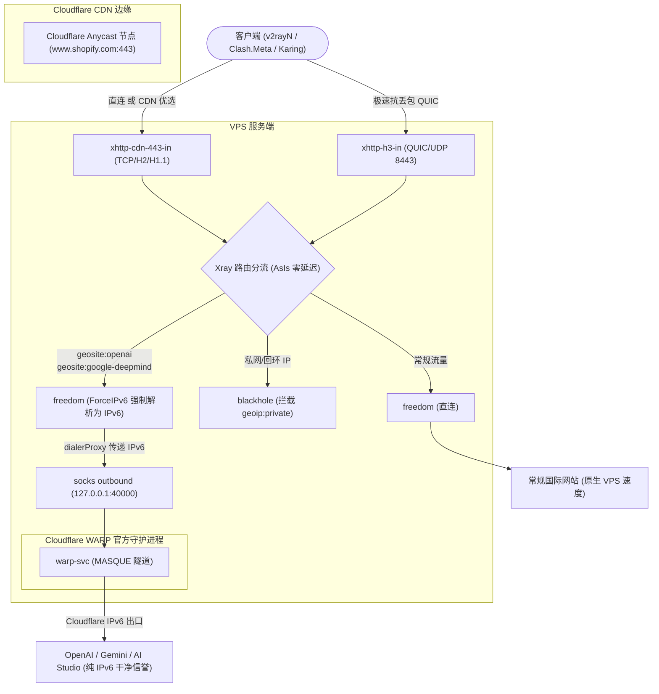
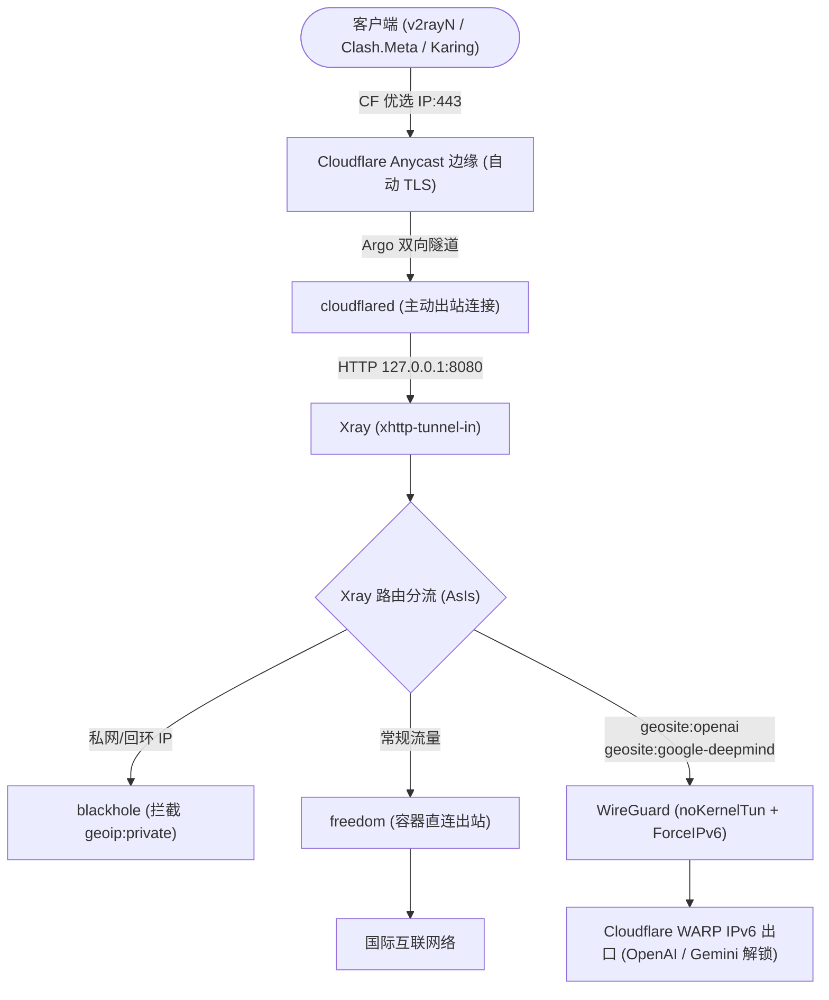

# xray-xhttp-warp

> **全官方原生架构**：Cloudflare 官方 WARP（SOCKS5 MASQUE 模式 / 轻量 WireGuard 模式） + Xray 官方最新内核（VLESS-XHTTP 双栈） + 严格 IPv6 分流（`ForceIPv6` 拯救 ChatGPT / Gemini 脏 IP） + 生产级 Systemd 守护与双 CLI 管理命令。
> 
> 🌟 **容器 / NAT 穿透模式**：全面适配 Docker、PRoot、LXC、NAT VPS 等**无 Systemd、无公网入站端口**环境，基于 Cloudflare 官方 Tunnel 隧道实现纯内网回源，仅部署极速优选节点，免证书、免开公网端口！

---

## 架构拓扑图

### 1. 标准原生 VPS 模式拓扑


### 2. 容器 / NAT 穿透模式拓扑 (Cloudflare Tunnel + WireGuard WARP 分流)


---

## 项目亮点

1. **纯官方组件与无 GUI 白名单精简部署**：
   - 原生模式 100% 使用 Cloudflare 官方 `cloudflare-warp` 与官方 `XTLS/Xray-core`；安装与升级 WARP 时按**核心依赖白名单**过滤，自动剥离桌面托盘 (`warp-taskbar`) 与所有非必需 GUI 图形依赖，并在安装后校验守护进程动态库 (`ldd`) 完整性，避免污染无头服务器并保持 `apt` 依赖健康。
   - 隧道模式在 Debian/Ubuntu Systemd 环境优先使用官方无 GUI `cloudflare-warp` 获取凭据；在精简容器/无 D-Bus 环境下自动改用 `xray wg` + Cloudflare 官方注册接口获取真实独立凭据。
2. **多模式智能适配与集成证书申请**：
   - **原生 VPS 模式**：双栈监听 (443/8443)，具备 CDN 优选、TCP 直连与 H3/QUIC 三种节点；并**可选附加开启 Cloudflare Tunnel 隧道入栈**（新增第 4 个隧道优选节点，`cloudflared -> 127.0.0.1` 免证书内网回源，支持随时通过 `xm tunnel` 动态开关）。**内置集成官方 `acmesh-official/acme.sh`**：支持 80 端口域名证书、Cloudflare/DNSPod/阿里云 DNS API（单域名与泛域名，无需开 80 端口、可全程保留 CF 小黄云）、以及 IP 短期证书，并配置自动续期重载 Xray；默认读取 `/etc/xray/cert/` 证书，也支持通过环境变量指定已有证书路径。
   - **容器/NAT 穿透模式**：专为无开放端口、无 Systemd 的容器/轻量沙箱（如 Altare、Docker、PRoot）量身定制，通过 `EnvironmentFile` 安全传递 Tunnel Token，免证书、免开公网端口。
3. **严格 IPv6 AI 分流与安全隔离**：
   - 解决痛点：WARP 的 IPv4 段被 OpenAI / Gemini 严格风控，而 WARP 的 **IPv6 段信誉极佳**。
   - 原生与隧道模式均启用 **`ForceIPv6`**，禁止 AI 域名回落到 WARP IPv4；同时默认启用 `geoip:private -> block` 防止本机/内网探测。
4. **全生态双 CLI 管理工具**：
   - 输入 `xm`：查看节点链接、启停服务、切换日志级别、更换 UUID、安全更新内核与 SHA256 校验规则库。
   - 输入 `warp`：管理 WARP 注册、启停、IPv4/IPv6 双栈出口测速、日志与升级。

---

## 快速安装

### 推荐：交互式主向导
```bash
bash <(curl -fsSL https://raw.githubusercontent.com/weiweibunan/xray-xhttp-warp/main/install.sh)
```

### 快捷安装指定模式

* **容器/NAT穿透模式（仅部署优选节点 + 隧道入栈）**：
  ```bash
  bash <(curl -fsSL https://raw.githubusercontent.com/weiweibunan/xray-xhttp-warp/main/install.sh) tunnel
  ```
  > 安装时会交互式提示输入 Cloudflare Tunnel Token 与绑定的隧道域名。

* **标准 VPS 模式（全套原生组件）**：
  ```bash
  bash <(curl -fsSL https://raw.githubusercontent.com/weiweibunan/xray-xhttp-warp/main/install.sh) all
  ```
  > 安装过程会询问是否额外开启 **Cloudflare Tunnel 附加隧道**（默认否 `[y/N]`，也可用 `xm tunnel` 随时开启/关闭）。支持通过环境变量指定已有证书：`CERT_PATH=/path/to/fullchain.pem KEY_PATH=/path/to/privkey.pem`；非交互式开启隧道可设置 `ENABLE_CF_TUNNEL=1 CF_TOKEN=... CF_DOMAIN=...`。

---

## 快捷管理命令

### 1. Xray 管理器 (`xm`)

| 命令 | 说明 |
| :--- | :--- |
| `xm` | 打开交互式管理控制台菜单 |
| `xm info` | 查看节点配置与一键 `vless://` 分享链接 |
| `xm restart` | 安全测试配置并重启服务 |
| `xm status` | 查看 Xray 及隧道运行状态 |
| `xm log` | 实时查看日志（默认 `loglevel` 为 `error` 仅记录错误，需看连接明细请先调为 `info`） |
| `xm loglevel <级别>` | 一键切换 Xray 日志级别（`error` / `warning` / `info` / `debug`） |
| `xm uuid` | 一键重新生成/更换用户 UUID |
| `xm tunnel` | （原生 VPS 模式）可选开启、更新、查看或关闭附加 Cloudflare Tunnel 隧道 |
| `xm token` | 更新 Cloudflare Tunnel Token 密钥与域名（纯隧道模式 / 已开启附加隧道时） |
| `xm cert` | 证书管理（`xm cert status` 查看、`xm cert issue` 申请/更换并应用、`xm cert renew` 强制续期） |
| `xm bbr` | 一键开启/检查系统 TCP BBR 拥塞控制加速 |
| `xm update-core` | 比对版本并校验 SHA256 升级 Xray 官方最新核心 |
| `xm update-geo` | 从 [Loyalsoldier/v2ray-rules-dat](https://github.com/Loyalsoldier/v2ray-rules-dat) 校验 SHA256 增量升级 `geosite.dat` / `geoip.dat` |
| `xm geo-cron` | 设置/查看/关闭规则库定时自动更新（`daily` / `weekly` / `days <N>` / `off`） |
| `xm test` | 校验 `/etc/xray/config.json` 语法正确性 |
| `xm uninstall` | 彻底卸载服务与清理配置 |

### 2. WARP 管理器 (`warp`)

| 命令 | 说明 |
| :--- | :--- |
| `warp` | 显示 WARP 管理帮助菜单 |
| `warp status` | 查看当前连接状态与接入点 |
| `warp test [端口]` | 测试本地 SOCKS5 代理的 IPv4 与 IPv6 双栈 WARP 出口状态 |
| `warp restart` | 重启官方 WARP 隧道连接 |
| `warp register` | 重新向 Cloudflare 注册客户端 |
| `warp logs` | 查看 WARP 官方后台日志 |
| `warp update` | 以无 GUI 精简方式升级官方 `cloudflare-warp` 客户端包 |

---

## 节点链接用途对照

* **🌐 优选节点：【VLESS - XHTTP - Cloudflare 优选节点】(隧道/原生模式均支持)**
  * 连接地址：`www.shopify.com`（或任何 Cloudflare 优选 IP/反代域名）
  * 特点：IP 隐藏在 Cloudflare 后面，防墙、救砖、晚高峰优化；原生模式同时可选额外挂载第 4 个 **CF Tunnel 优选节点**（`127.0.0.1` 免证书内网回源，无需暴露公网端口）。
* **🛡️ 直连节点：【VLESS - XHTTP - TCP 直连】(仅原生 VPS 模式)**
  * 连接地址：你的真实域名/IP (443)
  * 特点：直接连 VPS 443 端口，无 CDN 中转延迟损耗。
* **🚀 极速节点：【VLESS - XHTTP - H3 直连】(仅原生 VPS 模式)**
  * 连接地址：你的真实域名/IP (8443)
  * 特点：基于 QUIC/UDP，跨国高丢包网络（如移动宽带）下体验最佳。

---

## 项目目录结构

```text
xray-xhttp-warp/
├── README.md                          # 项目说明文档
├── install.sh                         # 主安装向导脚本
├── scripts/
│   ├── common.sh                      # 公共安装函数库（架构检测、校验下载、原子写配置等）
│   ├── install_cert.sh                # 集成官方 acme.sh 证书申请、安装与自动续期脚本
│   ├── install_tunnel.sh              # 容器/NAT穿透模式自动化安装脚本
│   ├── install_warp.sh                # Cloudflare 官方 WARP SOCKS5 自动化安装脚本
│   ├── install_xray.sh                # Xray 原生双节点 + ForceIPv6 分流主装机脚本
│   ├── warp_ctl.sh                    # /usr/local/bin/warp 管理工具（单文件自包含）
│   └── xm_ctl.sh                      # /usr/local/bin/xm 统一管理工具（单文件自包含）
├── systemd/
│   ├── cloudflared.service            # Cloudflare Tunnel 官方服务配置（EnvironmentFile 模式）
│   ├── warp-proxy-autoconnect.service # WARP 开机自动连接服务
│   └── xray.service                   # Xray 官方守护进程服务
└── config/
    ├── config.json.template           # 标准双节点配置文件模板
    └── config_tunnel.json.template    # 容器穿透模式配置文件模板
```

---

## 许可证
本项目基于 [MIT License](LICENSE) 开源。
