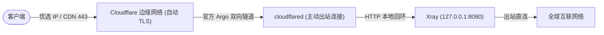

# xray-xhttp-warp

> **全官方原生架构**：Cloudflare 官方 WARP 客户端（SOCKS5 模式 / MASQUE 协议） + Xray 官方最新内核（VLESS-XHTTP 双栈） + 纯 IPv6 本地预解析分流（拯救 ChatGPT / Gemini 脏 IP） + 生产级 Systemd 守护与双 CLI 管理命令。
> 
> 🌟 **新增：容器/NAT 穿透模式**：全面适配 Docker、PRoot、LXC、NAT VPS 等**无 Systemd、无公网入站端口**环境，基于 Cloudflare 官方 Tunnel 隧道实现纯内网回源，仅部署极速优选节点，免证书、免开公网端口！

---

## 架构拓扑图

### 1. 标准原生 VPS 模式拓扑


### 2. 容器 / NAT 穿透模式拓扑 (Cloudflare Tunnel)


---

## 项目亮点

1. **纯官方原生组件**：
   - 拒绝 `warp-yg`、`wgcf`、`gost` 等第三方中间层，100% 使用 Cloudflare 官方原生客户端。
   - 代理核心采用官方 `XTLS/Xray-core` 原生单文件发行版。
2. **多模式智能适配**：
   - **原生 VPS 模式**：双栈监听 (443/8443)，具备 CDN 优选、TCP 直连与 H3/QUIC 三种节点，附带纯 IPv6 WARP 分流。
   - **容器/NAT 穿透模式**：专为无开放端口、无 Systemd 的容器/轻量沙箱（如 Altare、Docker、PRoot）量身定制，通过 Cloudflare Tunnel 主动出站穿透，仅部署 CDN 优选节点，免本地证书。
3. **精准 IPv6 AI 分流机制 (原生模式)**：
   - 解决痛点：WARP 的 IPv4 段被 OpenAI / Gemini 严格风控，但 WARP 的 **IPv6 段信誉极佳、100% 畅通**。
   - Xray 本地将命中的 AI 域名提前解析为 IPv6 AAAA 记录，再通过 `dialerProxy` 交付 40000 端口，从源头杜绝 IPv4 污染。
4. **全生态双 CLI 管理工具**：
   - 输入 `xm`：管理 Xray 节点查看、UUID 更换、Tunnel Token 更新、内核/规则库升级、服务控制。智能识别 Systemd 与容器进程自守护。
   - 输入 `warp`：管理 WARP 注册、启停、测速、日志、开机自启。

---

## 快速安装

### 推荐：交互式主向导
```bash
bash <(curl -fsSL https://raw.githubusercontent.com/weiweibunan/xray-xhttp-warp/main/install.sh)
```

### 快捷安装指定模式

* **容器/NAT穿透模式（仅部署优选节点 + 隧道入栈）**：
  ```bash
  bash <(curl -fsSL https://raw.githubusercontent.com/weiweibunan/xray-xhttp-warp/main/install.sh) tunnel
  ```
  > 安装时会交互式提示输入 Cloudflare Tunnel Token 与绑定的隧道域名。

* **标准 VPS 模式（全套原生组件）**：
  ```bash
  bash <(curl -fsSL https://raw.githubusercontent.com/weiweibunan/xray-xhttp-warp/main/install.sh) all
  ```

---

## 快捷管理命令

### 1. Xray 管理器 (`xm`)

| 命令 | 说明 |
| :--- | :--- |
| `xm` | 打开交互式图形化管理菜单 |
| `xm info` | 查看节点配置与一键 `vless://` 分享链接 |
| `xm restart` | 安全测试配置并重启服务 |
| `xm status` | 查看 Xray 及隧道运行状态 |
| `xm log` | 实时查看连接与分流日志（支持选择 Xray/隧道日志） |
| `xm uuid` | 一键重新生成/更换用户 UUID |
| `xm token` | （隧道模式）更新 Cloudflare Tunnel Token 密钥与域名 |
| `xm bbr` | 一键开启/检查系统 TCP BBR 拥塞控制加速 |
| `xm update-core` | 升级 Xray 官方最新核心 |
| `xm update-geo` | 更新 `geosite.dat` / `geoip.dat` 规则库 |
| `xm test` | 校验 `/etc/xray/config.json` 语法正确性 |
| `xm uninstall` | 彻底卸载服务与清理配置 |

### 2. WARP 管理器 (`warp`)

| 命令 | 说明 |
| :--- | :--- |
| `warp` | 显示 WARP 管理帮助菜单 |
| `warp status` | 查看当前连接状态与接入点 |
| `warp test` | 测试 `127.0.0.1:40000` SOCKS5 出口联通性与 IP |
| `warp restart` | 重启官方 WARP 隧道连接 |
| `warp register` | 重新向 Cloudflare 注册客户端 |
| `warp logs` | 查看 WARP 官方后台日志 |
| `warp update` | 升级官方 `cloudflare-warp` 客户端包 |

---

## 节点链接用途对照

* **🌐 优选节点：【VLESS - XHTTP - Cloudflare 优选节点】(隧道/原生模式均支持)**
  * 连接地址：`www.shopify.com`（或任何 Cloudflare 优选 IP/反代域名）
  * 特点：IP 隐藏在 Cloudflare 后面，防墙、救砖、晚高峰优化，免开公网端口。
* **🛡️ 直连节点：【VLESS - XHTTP - TCP 直连】(仅原生 VPS 模式)**
  * 连接地址：你的真实域名 (443)
  * 特点：直接连 VPS 443 端口，无 CDN 中转延迟损耗。
* **🚀 极速节点：【VLESS - XHTTP - H3 直连】(仅原生 VPS 模式)**
  * 连接地址：你的真实域名 (8443)
  * 特点：基于 QUIC/UDP，跨国高丢包网络（如移动宽带）下体验最佳。

---

## 项目目录结构

```text
xray-xhttp-warp/
├── README.md                          # 项目说明文档
├── install.sh                         # 主安装向导脚本
├── scripts/
│   ├── install_tunnel.sh              # 容器/NAT穿透模式自动化安装脚本
│   ├── install_warp.sh                # Cloudflare 官方 WARP SOCKS5 自动化安装脚本
│   ├── install_xray.sh                # Xray 原生双节点 + IPv6 分流主装机脚本
│   ├── warp_ctl.sh                    # /usr/local/bin/warp 管理工具
│   └── xm_ctl.sh                      # /usr/local/bin/xm 统一管理工具
├── systemd/
│   ├── cloudflared.service            # Cloudflare Tunnel 官方服务配置
│   ├── warp-proxy-autoconnect.service # WARP 开机自启动与断线守护服务
│   └── xray.service                   # Xray 官方守护进程服务
└── config/
    ├── config.json.template           # 标准双节点配置文件模板
    └── config_tunnel.json.template    # 容器穿透模式配置文件模板
```

---

## 许可证
本项目基于 [MIT License](LICENSE) 开源。
