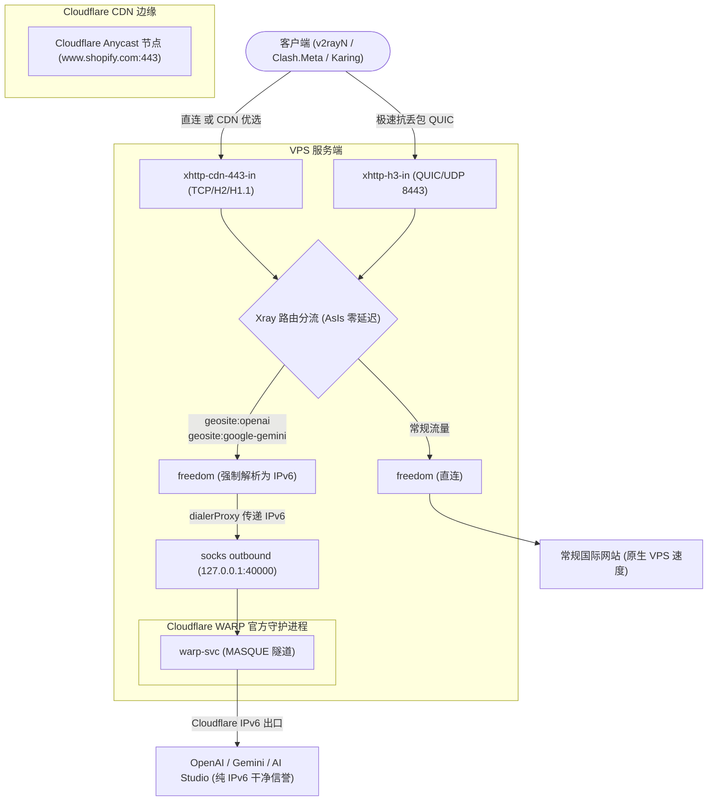

# xray-xhttp-warp

> **全官方原生架构**：Cloudflare 官方 WARP 客户端（SOCKS5 模式 / MASQUE 协议） + Xray 官方最新内核（VLESS-XHTTP 双栈） + 纯 IPv6 本地预解析分流（拯救 ChatGPT / Gemini 脏 IP） + 生产级 Systemd 守护与双 CLI 管理命令。

---

## 架构拓扑图



---

## 项目亮点

1. **纯官方原生组件**：
   - 拒绝 `warp-yg`、`wgcf`、`gost` 等第三方中间层，100% 使用 Cloudflare 官方 `cloudflare-warp` 客户端。
   - 代理核心采用官方 `XTLS/Xray-core` 原生单文件发行版。
2. **XHTTP (SplitHTTP) 前沿传输**：
   - **节点 1 (CDN 优选)**：监听 443 端口，支持套用 Cloudflare CDN 优选 IP（如 `www.shopify.com`），拯救被墙 IP，防封锁。
   - **节点 2 (TCP 443 直连)**：相同端口直连 VPS，无 CDN 损耗。
   - **节点 3 (H3 8443 直连)**：基于 QUIC/UDP，延迟更低、抗弱网丢包。
3. **精准 IPv6 AI 分流机制**：
   - 解决痛点：WARP 的 IPv4 段被 OpenAI / Gemini 严格风控（Access Denied / 验证码），但 WARP 的 **IPv6 段信誉极佳、100% 畅通**。
   - Xray 本地将命中的 AI 域名提前解析为 IPv6 AAAA 记录，再通过 `dialerProxy` 交付 40000 端口，从源头杜绝 IPv4 污染。
4. **双 CLI 管理生态**：
   - 输入 `warp`：管理 WARP 注册、启停、测速、日志、开机自启。
   - 输入 `xm`：管理 Xray 节点查看、UUID 更换、内核/规则库升级、服务控制。

---

## 快速安装

### 推荐：全套一键部署脚本
```bash
bash <(curl -fsSL https://raw.githubusercontent.com/weiweibunan/xray-xhttp-warp/main/install.sh)
```

> **执行前提**：
> 1. 系统推荐 **Debian 12 / 11** 或 **Ubuntu 22.04 / 24.04**；
> 2. 已准备好域名证书（放置在 `/root/ygkkkca/cert.crt` 与 `/root/ygkkkca/private.key`）。

---

## 快捷管理命令

### 1. Xray 管理器 (`xm`)

| 命令 | 说明 |
| :--- | :--- |
| `xm` | 打开交互式图形化管理菜单 |
| `xm info` | 查看当前 3 个节点的完整配置与 `vless://` 分享链接 |
| `xm restart` | 安全测试配置并重启 Xray 服务 |
| `xm status` | 查看 Xray 实时运行状态 |
| `xm log` | 实时查看连接与分流日志（按 `Ctrl+C` 退出） |
| `xm uuid` | 一键重新生成/更换用户 UUID |
| `xm bbr` | 一键开启/检查系统 TCP BBR 拥塞控制加速 |
| `xm update-core` | 升级 Xray 官方最新核心 |
| `xm update-geo` | 更新 `geosite.dat` / `geoip.dat` 规则库 |
| `xm test` | 校验 `/etc/xray/config.json` 语法正确性 |
| `xm uninstall` | 彻底卸载 Xray 服务与配置 |

### 2. WARP 管理器 (`warp`)

| 命令 | 说明 |
| :--- | :--- |
| `warp` | 显示 WARP 管理帮助菜单 |
| `warp status` | 查看当前连接状态与接入点 |
| `warp test` | 测试 `127.0.0.1:40000` SOCKS5 出口联通性与 IP |
| `warp restart` | 重启官方 WARP 隧道连接 |
| `warp register` | 重新向 Cloudflare 注册客户端 |
| `warp logs` | 查看 WARP 官方后台日志 |
| `warp update` | 升级官方 `cloudflare-warp` 客户端包 |

---

## 节点链接用途对照

* **🌐 节点 1：VLESS-XHTTP-CDN-Shopify (端口 443)**
  * 连接地址：`www.shopify.com`（或任何 Cloudflare 优选 IP/反代域名）
  * 特点：IP 隐藏在 Cloudflare 后面，防墙、救砖、晚高峰优化。
* **🛡️ 节点 2：VLESS-XHTTP-TCP-Direct (端口 443)**
  * 连接地址：你的真实域名
  * 特点：直接连 VPS 443 端口，无 CDN 中转延迟损耗。
* **🚀 节点 3：VLESS-XHTTP-H3-Direct (端口 8443)**
  * 连接地址：你的真实域名
  * 特点：基于 QUIC/UDP，跨国高丢包网络（如移动宽带）下体验最佳。

---

## 项目目录结构

```text
xray-xhttp-warp/
├── README.md                      # 项目说明文档
├── install.sh                     # 主安装向导脚本
├── scripts/
│   ├── install_warp.sh            # Cloudflare 官方 WARP SOCKS5 自动化安装脚本
│   ├── install_xray.sh            # Xray VLESS-XHTTP + IPv6 分流主装机脚本
│   ├── warp_ctl.sh                # /usr/local/bin/warp 管理工具
│   └── xm_ctl.sh                  # /usr/local/bin/xm 管理工具
├── systemd/
│   ├── warp-proxy-autoconnect.service # WARP 开机自启动与断线守护服务
│   └── xray.service               # Xray 官方守护进程服务
└── config/
    └── config.json.template       # Xray 核心配置文件模板
```

---

## 许可证
本项目基于 [MIT License](LICENSE) 开源。
